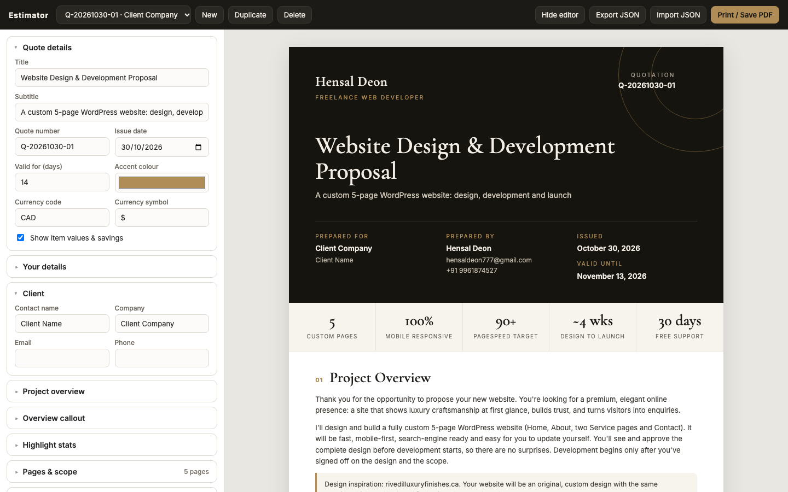

# Estimator: Quotation Builder

A lightweight, zero-install quotation builder for freelance web projects. Fill in a form on the left, see a polished, client-ready proposal update live on the right, and export it as a print-perfect A4 PDF.



## Features

- **Live editor and preview.** Every field updates the proposal as you type.
- **Client-ready PDF.** Print and save to PDF with A4 layout and clean page breaks. The dark cover and accents print in full colour.
- **Value-based pricing.** Each deliverable group shows a standard value, then a total value, a discount label, the final package price and "You save". You can switch values off for a price-only quote.
- **Automatic payment schedule.** Milestone amounts are calculated from the package price and percentages. The editor warns you when the percentages don't add up to 100%.
- **Complete proposal sections:**
  - cover and highlight stats
  - project overview
  - pages and scope
  - what's included
  - technology
  - investment
  - payment schedule
  - timeline with milestones
  - third-party costs
  - optional add-ons
  - client requirements and exclusions
  - terms
  - signature block
- **Multiple quotes.** Quotes save automatically in your browser. You can create, duplicate, switch between and delete them.
- **Portable.** Export or import any quote as JSON for backup, version control or reuse on another machine.
- **Brandable.** Set the accent colour, currency code and symbol, and your own details.
- **No dependencies.** Plain HTML, CSS and JavaScript. There's no build step, framework or server.

## Quick start

1. Clone the repository:
   ```bash
   git clone git@github.com:HensalDeon/ESTIMATOR.git
   cd ESTIMATOR
   ```
2. Open `index.html` in any modern browser by double-clicking it, or serve the folder with a local server such as VS Code Live Server.

That's it. There's nothing to install.

## Workflow

1. Click **New** to start a quote from the default template.
2. Fill in **Client** and **Quote details**, which include the quote number, date, validity and currency.
3. Adjust scope, deliverables, pricing and the timeline in the editor sections. List sections can be added, removed and reordered with the ↑ ↓ ✕ buttons.
4. Click **Hide editor** to review the full proposal as the client will see it.
5. Click **Print / Save PDF** and choose **Save as PDF**. The file name defaults to `Quotation <number> - <client>`.

### Getting the best PDF

In the browser's print dialog:

- **Destination:** Save as PDF
- **Paper size:** A4
- **Margins:** Default
- **Background graphics:** On, needed for the dark cover and accents

Each printed page gets its own footer (your name, quote number and "Page X of Y"), which replaces the browser's default URL and date headers. Chrome and Edge give the most accurate results.

## Customising the default template

Every new quote starts from [`template.js`](template.js). Edit it once to set up your standard offer:

| Key | What it controls |
| --- | --- |
| `from` | Your name, tagline, email, phone and website |
| `meta` | Title, subtitle, numbering, validity days, currency, accent colour, value display |
| `intro`, `overviewNote` | Project overview paragraphs and the highlighted callout |
| `highlights` | The stat strip under the cover, for example "90+ PageSpeed target" |
| `pages` | Pages in scope and the key sections of each |
| `groups` | Deliverable groups, each with a standard `value` and an `items` list |
| `tech` | Technology and setup tags |
| `pricing` | Package price, discount label and pricing note |
| `payment` | Payment milestones and percentages, which should total 100 |
| `timeline` | Phases, durations and milestone flags |
| `thirdParty` | Costs the client pays directly, such as domain and hosting |
| `addons` | Optional upsells with a price and unit |
| `clientProvides`, `exclusions`, `terms` | Requirements, exclusions and terms, as plain string lists |
| `acceptance` | Sign-off text above the signature lines |

Changes to `template.js` apply to **new** quotes only. Quotes you've already saved keep their own content.

## Data and privacy

- Quotes are stored in your browser's `localStorage`. Nothing is sent to a server.
- Browser storage is local to that browser and profile. Clearing site data removes your quotes, so use **Export JSON** to keep backups of important ones.
- The only external request is for Google Fonts (Cormorant Garamond and Inter). Without an internet connection, the app falls back to system fonts.

## Project structure

```
.
├── index.html     # App shell: toolbar, editor panel, preview container
├── styles.css     # Editor UI, proposal design and print (A4) styles
├── app.js         # Editor schema, rendering, storage, import/export, print
├── template.js    # Default quotation content for new quotes
└── docs/
    └── screenshot.png
```

### How it works

- **`SCHEMA`** in `app.js` declares each editor section and its fields. There are four kinds: `object`, `list`, `text` and `lines`. To add a field to the editor, add an entry there. It's then rendered and bound automatically.
- **`renderPreview()`** builds the proposal from the current quote state. Empty sections are skipped and section numbers adjust automatically.
- **State** is a single plain object per quote. It's saved to `localStorage` with a short debounce after each change.

## Browser support

The app works in current Chrome, Edge, Firefox and Safari. For PDF export, Chromium-based browsers give the most faithful page breaks.
